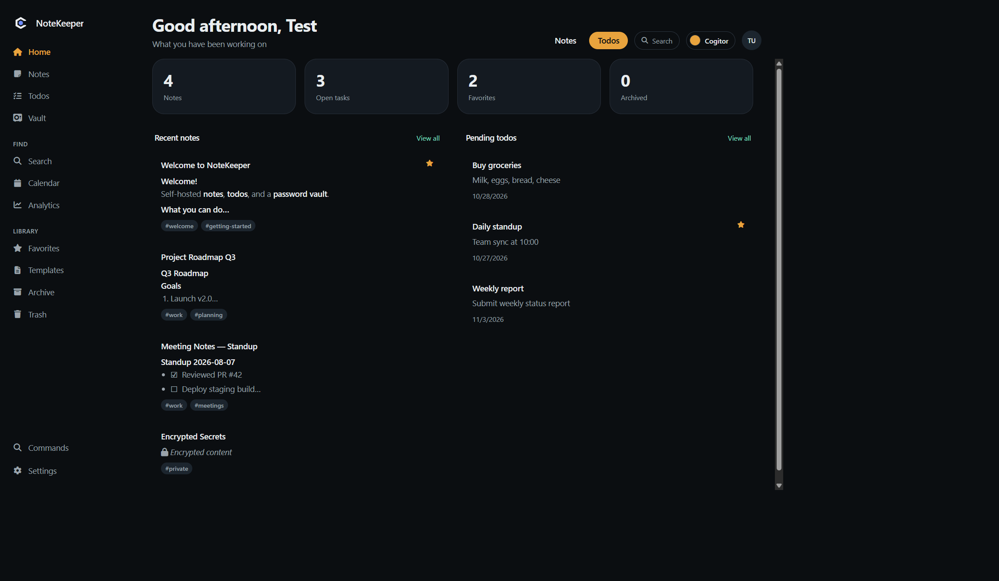
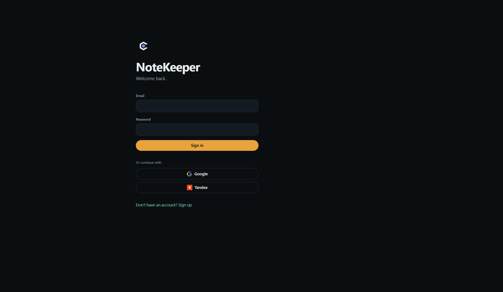
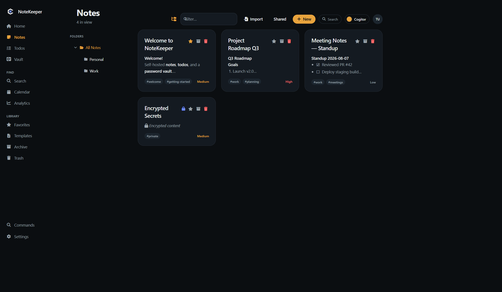
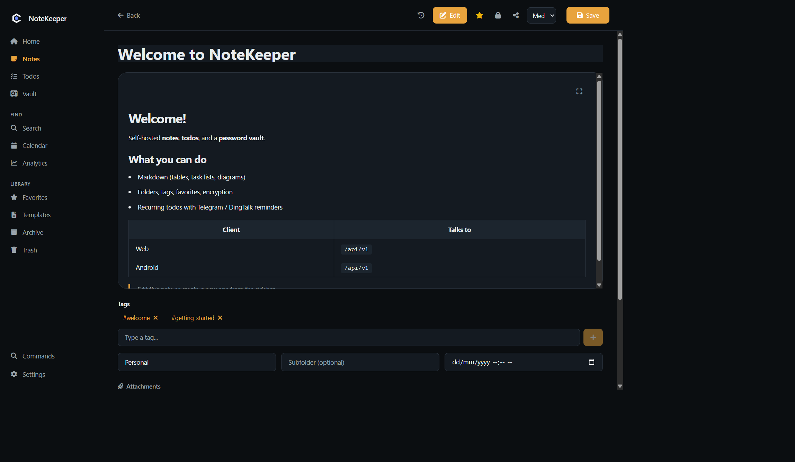
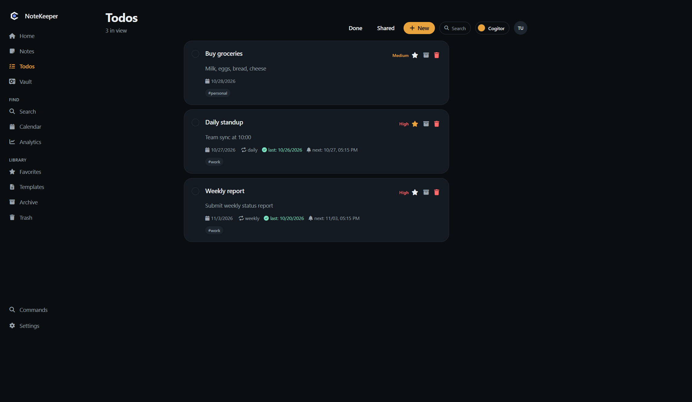
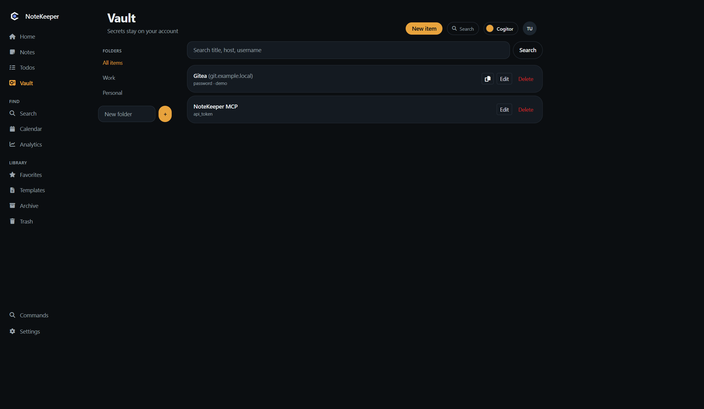
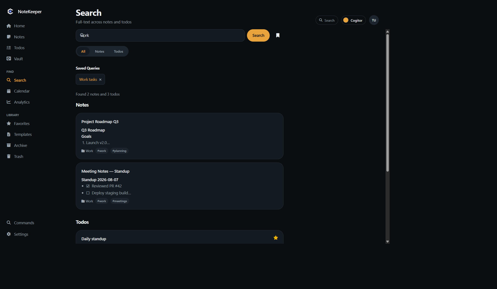
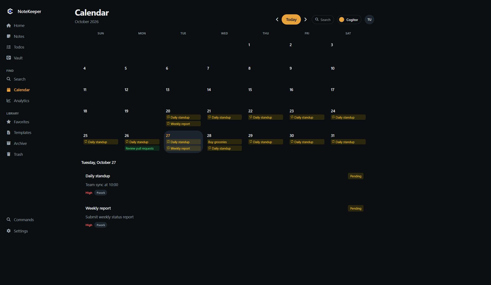
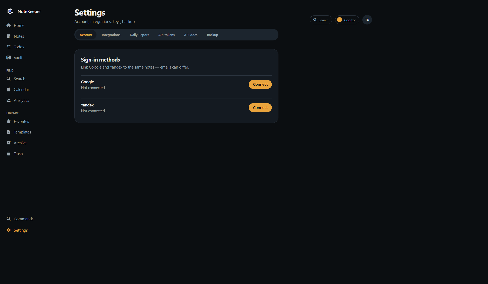
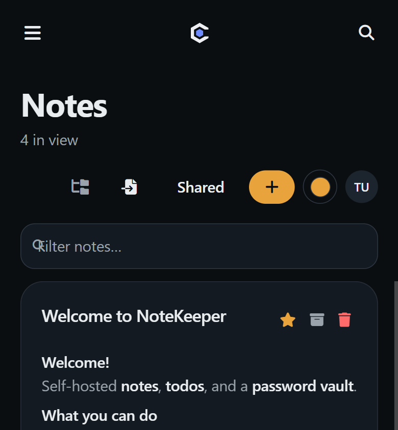

# NoteKeeper user guide

Version **2.0.2**. Self-hosted notes, todos, and a password vault. Web UI ships in the server; Android talks to the same `/api/v1`.

Product overview and deploy: [README.md](../README.md). Releases: [CHANGELOG.md](../CHANGELOG.md).

## Sign in

Open the app URL (default `http://localhost:8080`, HashRouter: `#/login`).

| Method | How |
|--------|-----|
| Email | Register or sign in with email + password |
| Google / Yandex | Buttons show when the server has `GOOGLE_CLIENT_ID` / `YANDEX_CLIENT_ID` |
| Link accounts | After login: **Settings → Account** — attach Google or Yandex to the same user |

JWT lasts 24 hours. On Android, sign-in uses Custom Tabs and returns via `notekeeper://oauth` (Chrome preferred so Edge does not intercept the redirect).

## Layout

- **Desktop:** sidebar + main pane. Theme picker and account menu sit in the page header.
- **Narrow / phone:** hamburger opens the same sidebar as a drawer.
- **Command palette:** Search button in the header (and the magnifier on mobile). Jump to notes, todos, or pages.

Sidebar groups:

| Group | Pages |
|-------|--------|
| Main | Home, Notes, Todos, Vault |
| Find | Search, Calendar, Analytics |
| Library | Favorites, Templates, Archive, Trash |
| Footer | Settings |

Default theme is **cogitor**. Switch palettes from the header (13 total). Choice is stored in the browser.

## Home

Counts for notes, open tasks, favorites, and archive. Recent notes and pending todos.

From Home, **Notes** / **Todos** in the header jump to those lists.

## Notes

**New note** creates an untitled note in the selected folder and opens the editor.

Left panel is the folder tree (from note paths; no separate folder table). Root = unfiled / `default`. Filter by folder, search the list, or show notes shared with you. Drag a note onto a folder to move it.

On a card: favorite, archive, trash. Encrypted notes show a lock; shared notes show a share icon.

### Editor

- Title + Markdown body. Empty notes open in edit; others open in preview.
- Autosave. **Ctrl/Cmd+S** also saves.
- Toolbar: Markdown snippets, attachments, lock (AES-256-GCM on the server), share, history, fullscreen.
- Preview: GFM (tables, task lists, strikethrough), fenced code, Mermaid, images (including JWT-protected attachments).
- Tags, folder, priority, reminder (display only — no push), favorite.

**Share** invites another user by email/name (they must already have an account).

**History** (clock in the note toolbar — web and Android): each server save writes `created` / `edited` / `restored`. Tap a row to **preview** that Markdown. Restore writes the body now and adds a `restored` row. Android needs the note synced; unsynced local notes have no server history yet.

**Import:** `.txt` and `.md` only, into the current folder. PDF/Office files are not parsed.

Server encryption key: `app.encryption.key` / `APP_ENCRYPTION_KEY`. If the key changes, encrypted notes become unreadable.

## Todos

**New todo** opens the editor. Toggle completed on the card. Filter completed vs open; show items shared with you.

### Editor and schedule

- Title + Markdown description, tags, priority, attachments, share.
- **Due / start** and **reminder** (datetime).
- Repeat: `none`, `daily`, `weekly`, `monthly`, `weekdays`, `custom` (days of week). Repeating todos need a due date or reminder as the anchor.
- Recurring **completed** means done for the **current period only**. Next period it is open again. History is in the completion log.
- Reminders go to Telegram and/or DingTalk if those are configured. Notify does **not** move the reminder time; completing (or rollover) does.

Send a one-off test from the todo editor if integrations are on.

## Vault

Folders + items on the account (`/api/v1/vault`). Types: password, SSH key, API token, secure note.

**New item** uses the folder selected on the left (`New in far`). To move: pick a folder on the row, drag the grip onto a folder, or set Folder in Edit.

Copy password, download PEM for keys. Android can copy the secret to the clipboard.

This is **server-side** storage behind JWT — not a local SQLCipher vault (Android cache for vault is not encrypted at rest yet).

## Search, calendar, analytics

**Search** — full-text across notes and todos. Restrict to notes or todos. Save a query for reuse.

**Calendar** — month grid of todos (due/reminder) and notes with a reminder. Recurring completions mark past days.

**Analytics** — counts, tags, priority mix, activity for week / month / year.

## Library

| Page | |
|------|--|
| Favorites | Starred notes and todos |
| Templates | Named Markdown snippets; **Use** creates a note with that body and tags |
| Archive | Soft-parked notes/todos; restore from here |
| Trash | Soft-deleted items; restore or permanent delete |

## Settings

| Tab | |
|-----|--|
| Account | Profile; link / unlink Google and Yandex |
| Integrations | Telegram bot token + chat ID; DingTalk webhook + optional HMAC secret. Test send. |
| Daily report | Time (local, stored as UTC), channels, templates |
| API tokens | Personal tokens `nk_…` with scopes `notes`, `todos`, `vault`, `mcp` |
| API docs | Pointer to Swagger `/swagger-ui.html` |
| Backup | Cron (default 02:00), retention, export / import / list |

Theme is in the header, not in Settings.

## Android

Package `dev.cogitor.notekeeper.v2`, minSdk 31. Point the client at your server URL (HTTPS in production).

Bottom nav: **Notes | Todos | Vault | Search**. Gear on every tab opens **Settings** (theme, notifications, Telegram/DingTalk, backup, API tokens, **Log out**).

- Pull to sync. Notes/todos also sync in the background (Room + WorkManager).
- List chips: notes **All | Archive | Trash**, then folder chips from `folder`/`subfolder` (same paths as web). Todos **Active | Done | Archive | Trash**. Swipe a note left → archive (snackbar **Undo**). Swipe a todo right → done, left → archive. In Archive/Trash, swipe to restore. FAB only on the Active list so it does not cover archive/trash cards. New note lands in the selected folder.
- Vault chips: **All** plus server folders (`GET /vault/folders`). Type a name + plus to create. New secret inherits the selected folder; the editor can move it.
- Back (system or arrow) saves the open note/todo. Empty title with body becomes **Untitled**. Empty new drafts are discarded.
- Note editor: pencil / eye in the top bar (edit vs preview). Existing notes open in Preview (rendered Markdown); new notes open in Edit. Amber check FAB saves (snackbar **Saved**); notes also autosave ~800 ms. Keyboard resizes the editor (does not pan the title off-screen). Overflow **⋮**: Share, History, Attach, Trash. Tags suggest existing values (same `GET /tags` as web, plus local cache); space / comma / Done commits a chip. Folder field accepts `Work/Q1` and suggests known paths.
- Sign-in: email/password, Google, Yandex.

Details: [android/README.md](../android/README.md).

## API and other clients

`Authorization: Bearer <jwt or nk_ token>`. Interactive docs: `/swagger-ui.html`.

MCP endpoint: `POST /mcp` (token scope `mcp`). FAR Manager plugins are a separate repo — see `far-vault/README.md`.

## Keyboard and palette

Global shortcut bindings were removed. Use the **Search** control in the header for the command palette (new note, new todo, navigation, title search). Editors still handle **Ctrl/Cmd+S** and **Esc** (exit fullscreen).

## Mobile web

Same app. Drawer navigation, large tap targets, command palette from the top-right magnifier.
